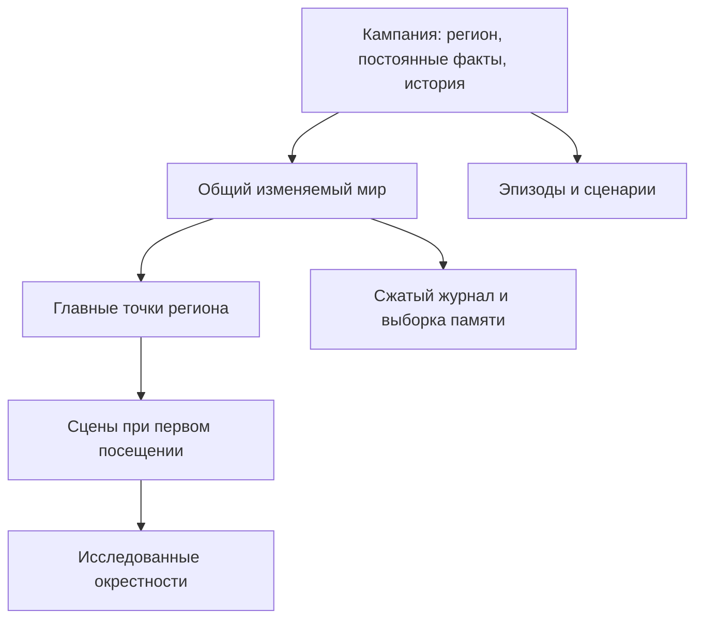

# Кампания над сценариями

Кампания владеет миром, общим временем, географией и историей. Сценарий —
локальное приключение в этом мире. Его состояние не должно становиться
границей мира или поводом стереть отношения и созданные места.



Первый работающий слой доступен как «Речное пограничье · кампания» в меню
сеансов. Обычные сценарии продолжают работать самостоятельно.
Следующий этап, 25 ноября: [зацепки, источники и продолжение расследования](campaign-investigation-2026-11-25.md).

API создания: `POST /api/games` с
`{"action":"create","campaign":"river-marches","name":"Долгая дорога"}`.
Выбор героев и группы использует прежние `hero_id`/`party`. Поля `campaign`
и `scenario` при создании взаимоисключающие.

## Что задаётся заранее

`rules/campaigns/river-marches.json` содержит границы одной долины, предпосылку,
постоянные факты, шесть главных точек и связи между ними. Берег, старый паром,
новый мост, дозорная башня, каменоломни и плавни существуют как краткие заготовки,
не как подробно расписанные комнаты.

Первый эпизод `crossroads` предоставляет рыночную площадь и знакомых NPC.
Это адаптер для существующего сценария. Поле `scenario_id` пока сохраняется
для совместимости со старой механикой; новая кампания находится отдельно
в `state.campaign`, её описание — в отдельном каталоге. Новый регион не нужно
добавлять в каталог сценариев.

Кампания хранит список эпизодов. В этой версии реализован запуск первого;
автоматический выбор следующих приключений, завершение/подключение новых
эпизодов и автономные планы фракций ещё не реализованы. Это основа большого
мира, а не уже готовый многолетний сюжет.

## Что создаётся по ходу

Первый переход к неизвестной главной точке вызывает отдельный генератор.
Он получает границы, постоянные факты, заготовку места и ограниченный канон
соседних созданных сцен. История всей кампании ему не передаётся.

Генератор возвращает описание, до двух новых NPC и до трёх объектов. Движок
проверяет форму, размеры и уникальность имён. ID, характеристики и механические
эффекты назначает движок; модель не может патчить старых NPC, кошельки,
инвентарь или ранее созданное место. Дубликат Селены вместо нового NPC
отклоняется. Проверка структуры не доказывает смысловую непротиворечивость
каждой фразы — это остаётся ограничением модели.

`explore(target=текущая точка, method=название)` создаёт новое небольшое место
в её окрестностях и переводит туда группу. Например: «Исследую старую лодочную
у этого высокого берега и иду туда». Идентичность определяется родителем и
нормализованным названием; повтор не создаёт вторую лодочную. Название само
по себе не является географическим валидатором: выполнение границ в тексте
модели всё ещё требует проверки качества.

Сейчас разрешены до 24 дочерних мест у точки и глубина до трёх уровней.
Это технические ограничения первой версии. За пределами региона новая область
автоматически не появляется. За одну заявку создаётся не более двух мест;
план может подготовить место до фактического прохождения предшествующей
проверки. Возврат в уже созданное место генерацию не вызывает.

При неверном структурированном ответе допускается одна коррекция с конкретной
ошибкой валидатора. Оба вызова учитываются в квоте. Сетевые ошибки автоматически
не повторяются. Превышение квоты, неверный ответ или устаревшая ревизия не
публикуют частично созданный мир. Деньги и кости генератор не тратит.

Созданные предметы — простые вещи/улики без сгенерированной цены и боевых
свойств. Вскрываемое препятствие использует ограниченный профиль двери/ящика.
Произвольные новые заклинания, механики, награды, бои с новыми NPC и физические
эффекты этой версией не добавлены.

## Как сохраняется память

- Созданная сцена сохраняется один раз как неизменяемый сжатый JSON-фрагмент
  в `campaign_blobs`, с адресом по хешу содержимого.
- Активное состояние содержит ссылки и изменения относительно фрагментов:
  например, нового владельца записки или изменившееся отношение NPC.
- После накопления более 96 записей истории в активном состоянии остаются
  последние 64, а остальные без потери полей уходят в сжатый журнал.
- Блоки журнала связаны в цепочку. Сохранение держит только её вершину;
  загрузка старой ветки не читает будущую цепочку другой ветки.
- По тексту запроса и участникам выбираются до четырёх архивных блоков и
  до трёх прошлых записей. У них сохраняются автор, аудитория и источник.
- Результаты запросов ссылаются на сжатые снимки, вместо нескольких полных
  копий мира в квитанции и следе ИИ. Повтор UUID возвращает исходный результат.

Модель получает текущую сцену, главные точки, соседние места, связанные
с запросом имена и выбранные воспоминания. Схема допустимых ссылок также
составляется по этой выборке. Тысяча далёких мест не превращается в тысячу
описаний внутри каждого запроса.

Поиск архива пока лексический, с предпочтением участникам разговора, а не
семантический. За один поиск просматриваются метаданные не более 4096 блоков.
Старые блоки за этим окном не удаляются, но произвольное воспоминание из них
эта версия автоматически не найдёт. Выбранные фрагменты также не гарантируют,
что модель правильно назовёт автора слов.

Резервная копия должна включать SQLite-базу целиком: отдельный JSON активного
состояния без фрагментов недостаточен. Пока нет сборщика недостижимых
фрагментов; прошлые ветки и отвергнутые после возврата открытия остаются
физически в базе. Подробные трассы ИИ тоже продолжают занимать место.

## Проверки и практические пределы

```bash
PYTHONPATH=src python3 -m unittest discover -s tests -v
PYTHONPATH=src python3 -m unittest discover -s release_tests -v
PYTHONPATH=src python3 release_tests/live_multiplayer.py --live --case campaign_journey
```

При проверке первого слоя 24 ноября прошли 318 обычных тестов и 12 отдельных проверок, включая настоящий
перезапуск процесса. Проверены возвращение в созданную сцену без генерации,
повтор запроса, изменения инвентаря и NPC, коррекция дубликата, ошибки сети,
квоты, устаревшие результаты и изоляция веток сохранения.

Модельная проверка с 510 местами и 10 000 событиями дала:

| Величина | Размер |
| --- | ---: |
| Полный JSON мира | 1 183 008 байт |
| Активная запись приключения | 77 887 байт |
| Сжатые фрагменты теста, включая журнал | 258 290 байт |
| Контекст текущей сцены | 25 310 байт |

Это синтетические данные, не 10 000 живых ходов. Число сжатых байт не является
размером всей базы: оно не включает её служебные страницы, чат и многолетние
трассы внешних вызовов. Обработка мира пока восстанавливает все фрагменты
в памяти процесса; для существенно большего масштаба понадобятся выборочная
загрузка сущностей и отдельная политика хранения трасс. Совместимость
будущих версий формата тоже потребует миграций. Работа «годами» не доказана
этим тестом.

В живом контрольном маршруте бесплатная модель создала берег, местную
лодочную и старый паром; возвращение сохранило прежний берег, а загрузка
сохранения исключила будущие открытия. Промежуточный прогон выявил дубликат
Селены и неверный отказ исследовать лодочную — после этого добавлены проверка
имени, одна коррекция и уточнение разбора исследования. Трассы и изолированные
базы хранятся локально в `.local/campaign-live-*.json` и `.sqlite3`.
Финальный повтор: 14 внешних вызовов, 3 созданные сцены, 34 проверки состояния
и протокола, все прошли; заявленная стоимость 0. Вместе с двумя предыдущими
прогонами выполнен 41 вызов. Художественный текст всё ещё содержит языковые
шероховатости и может добавлять неподтверждённые подробности. Проход тестов
не означает доказанной согласованности долгого сюжета.
